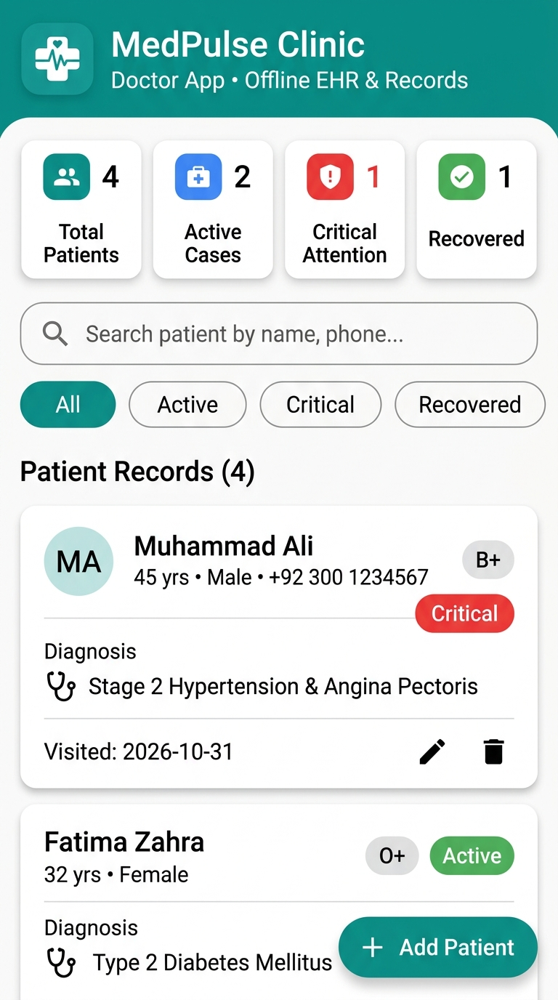
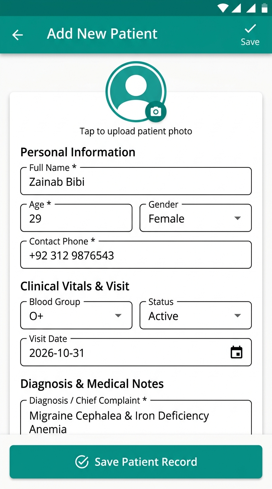
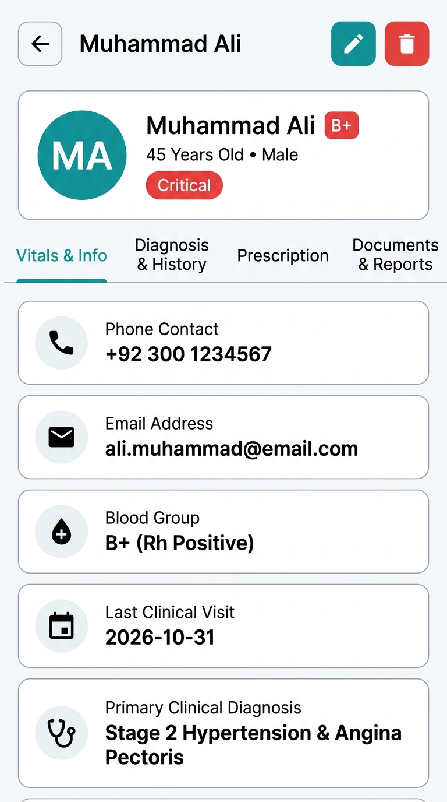
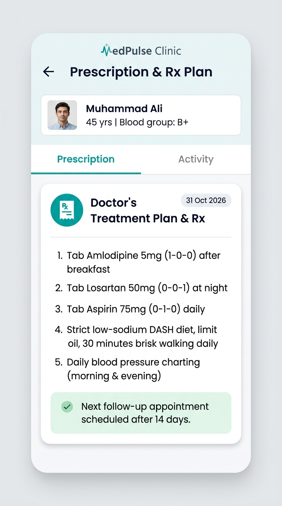
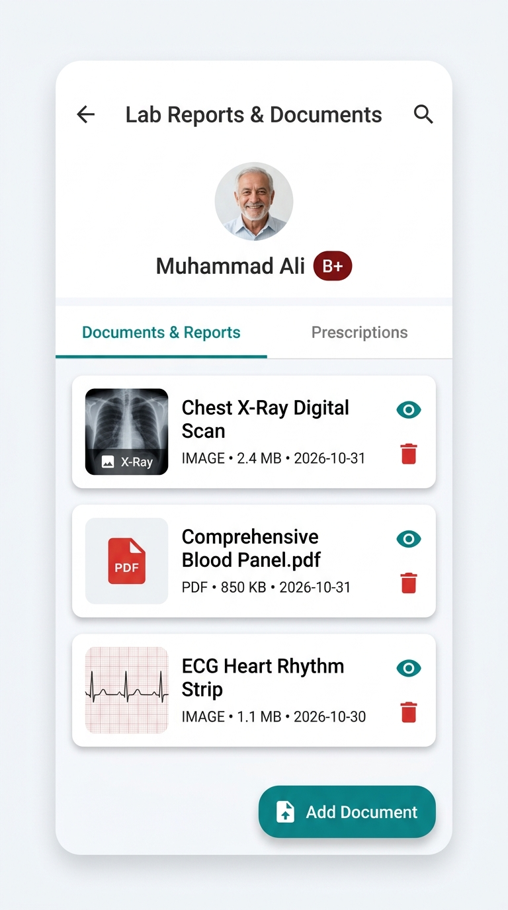
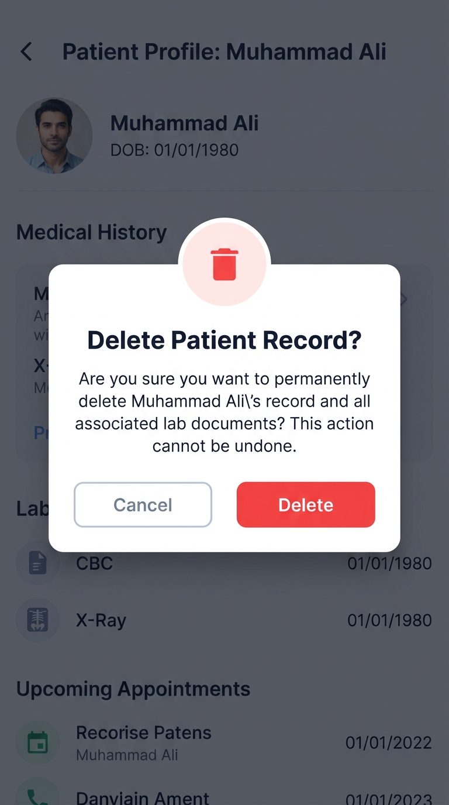

# MedPulse Doctor App — Quiz 2 Activity

A modern, responsive, and offline-first **Doctor Patient Management App** built with **Flutter** and **SQLite** for daily clinical use.

---

## 🌟 Key Features Implemented

1. **Patient Management (Full CRUD):**
   - **Create (Add Patient):** Add new patients with avatar photo, full name, age, gender, phone, email, blood group, diagnosis, medical history/allergies, doctor prescription, and clinical visit date.
   - **Read (View List & Vitals):** View complete patient list with real-time search (by name, phone, or condition), filter by clinical status (Active, Critical, Recovered, Follow-up), and sort by recent, name, or age.
   - **Update (Edit Patient):** Edit any patient record with pre-populated form fields and instant validation.
   - **Delete (Safe Delete):** Confirmation dialog with defensive UX before deleting patient records and cascade-clearing associated documents.

2. **Local Database (SQLite):**
   - High-performance offline storage powered by `sqflite` (and `sqflite_common_ffi` for Windows desktop).
   - Foreign-key relationships between `patients` and `patient_documents` tables with automatic cascade deletion.
   - Realistic pre-seeded medical records on first launch.

3. **File Management & Lab Reports:**
   - Upload and manage medical documents, prescriptions, lab reports, and clinical scans (Images, PDFs, Documents).
   - Files are copied securely to the application's local documents sandbox.
   - In-app interactive preview screen with zoom and pan support.

4. **Modern, Doctor-Friendly UI:**
   - Healthcare palette: Medical Teal (`#0D9488`), Clinical Sky Blue (`#0284C7`), and Coral Crimson (`#EF4444`).
   - Clean card-based dashboard with top metric counters (Total, Active, Critical, Recovered).
   - Color-coded badges for blood group (`B+`, `O+`, `A+`, etc.) and status indicators.
   - Responsive Material 3 design with clean typography via `GoogleFonts.inter`.

---

## 📁 Project Structure

```
d:/SDQ2/
├── Quiz 2/                              # Submission folder for GitHub
│   ├── main.dart
│   ├── database/
│   │   └── db_helper.dart               # SQLite database helper & CRUD operations
│   ├── models/
│   │   ├── patient.dart                 # Patient data model
│   │   └── patient_document.dart        # Document & lab file model
│   ├── screens/
│   │   ├── home_screen.dart             # Dashboard, search, filters & patient list
│   │   ├── patient_detail_screen.dart   # Patient overview, tabs & document manager
│   │   ├── add_edit_patient_screen.dart # Add & Edit patient form
│   │   └── document_preview_screen.dart # In-app document and image viewer
│   ├── theme/
│   │   └── app_theme.dart               # Medical color palette & design tokens
│   ├── widgets/
│   │   ├── patient_card.dart            # Patient item card with badges
│   │   ├── stat_card.dart               # Top metric count card
│   │   └── search_filter_bar.dart       # Live search & filter chips
│   └── screenshots/                     # 6 High-resolution UI screenshots
│       ├── 1_view_patient_list.jpg
│       ├── 2_add_new_patient.jpg
│       ├── 3_patient_detail_overview.jpg
│       ├── 4_doctor_prescription.jpg
│       ├── 5_documents_and_reports.jpg
│       └── 6_delete_patient_dialog.jpg
├── lib/                                 # Standard Flutter project lib source
├── screenshots/                         # Project root screenshots
└── pubspec.yaml
```

---

## 📸 Screenshots Overview

| 1. Patient List & Dashboard | 2. Add New Patient Form | 3. Patient Vitals Overview |
|:---:|:---:|:---:|
|  |  |  |

| 4. Doctor Prescription & Rx | 5. Lab Reports & File Management | 6. Delete Confirmation Modal |
|:---:|:---:|:---:|
|  |  |  |

---

## 🚀 How to Run the App

1. Ensure Flutter is installed:
   ```bash
   flutter --version
   ```

2. Install dependencies:
   ```bash
   flutter pub get
   ```

3. Run on your desired platform:
   - **Windows Desktop:**
     ```bash
     flutter run -d windows
     ```
   - **Android / iOS Device or Emulator:**
     ```bash
     flutter run
     ```
